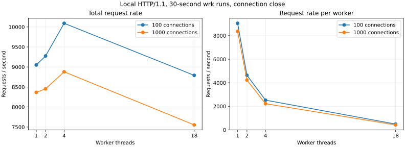

# ZT-Proxy

[](.github/workflows/ci.yml)

A working Linux C++20 forward proxy with HTTP forwarding, HTTPS CONNECT tunnels, destination allowlisting, DNS-pinned SSRF protection and TLS SNI checks without decryption. Networking uses POSIX sockets and epoll directly; the executable has no third-party networking, HTTP or JSON library dependency. This Kubernetes branch uses OpenSSL libcrypto solely for SHA-256 policy/identity hashing; it does not terminate TLS.

The project lives on the Linux ext4 filesystem at `/home/mohit/projects/zt-proxy`. The original specification is preserved in [docs/spec.md](docs/spec.md). The `kubernetes` branch adds a [local three-node Kubernetes deployment](docs/kubernetes.md), policy control plane and Redis rate limiting. See [checkpoints](docs/checkpoints.md) for implementation history, [architecture](docs/architecture.md) for security and concurrency details, and [interview notes](docs/interview.md) for explanations.

## Build and run

```bash
sudo apt-get install -y build-essential cmake libgtest-dev libssl-dev python3-pytest openssl curl
cmake --preset release
cmake --build --preset release
./build/release/zt-proxy --config config/zt-proxy.json --check-config
./build/release/zt-proxy --config config/zt-proxy.json
```

In another terminal:

```bash
curl --noproxy '' -x http://127.0.0.1:3128 https://example.com/
curl http://127.0.0.1:9100/healthz
curl http://127.0.0.1:9100/metrics
# Unknown destinations are blocked with HTTP 403 and X-ZT-Block.
curl -i --noproxy '' -x http://127.0.0.1:3128 http://unapproved.example/
```

The example permits HTTPS to `example.com`, its subdomains and `api.openai.com`; everything else is denied. Edit the operator-controlled allowlist for your application. Plain HTTP additionally requires an entry in `http_allowlist`. Tests use their own isolated local configuration and never contact the Internet.

Send `SIGHUP` to reload policy, tokens, limits and timeouts atomically. Send `SIGTERM` or press Ctrl-C for a graceful stop. `--help`, `--version` and `--check-config` are available. Changing listeners, worker count, resolver count or log path requires restart; failed reloads preserve the active configuration.

## What is implemented

- Nonblocking IPv4/IPv6 forwarding, bounded bidirectional buffering, backpressure, write half-closes and connection deadlines.
- One epoll loop and SO_REUSEPORT listener per worker; bounded read/accept budgets, eventfd resolver completion and timerfd deadlines.
- Strict incremental HTTP/1.1 request parsing, fixed-length and chunked uploads, hop-by-hop stripping and request-smuggling rejection.
- Deny-by-default host/port policy, exact and wildcard rules, suspicious-host checks, all-answer public-IP checks and connection to pinned sockaddr values.
- Fragmented TLS ClientHello/SNI parsing, domain-fronting and raw-tunnel rejection; no TLS interception.
- Bearer authentication, per-client token buckets and connection limits, immutable configuration snapshots and graceful drain.
- Loopback health/Prometheus endpoints and asynchronous bounded JSONL access logs.
- An adapter exercised with the existing SentinelAgent EgressClient and DLP implementation.

Plain HTTP handles **one request per connection** and sends `Connection: close`. TLS tunnels remain bidirectional until EOF/deadline. No-SNI/ECH falls back to CONNECT host/IP policy. Local rate and per-client connection limits are **per worker**; optional Redis mode shares request-rate buckets across replicas. Read the [documented boundaries](docs/architecture.md#known-boundaries), including the libc DNS shutdown caveat, before deployment.

## Configuration and authentication

[config/zt-proxy.json](config/zt-proxy.json) is a complete runnable example. Unknown keys, duplicate JSON keys, invalid ranges/types, malformed host patterns and unsafe binds are rejected. Names are normalized to lowercase; use explicit ASCII punycode entries for IDNs.

| Setting | Purpose |
| --- | --- |
| `listen`, `port` | Numeric bind address and unprivileged port; default loopback:3128 |
| `admin`, `admin_port` | Default loopback :9100; explicit `admin_allow_remote` plus proxy authentication permits cluster probes/scraping |
| `workers`, `resolver_threads` | Worker and DNS thread counts; omitted workers use hardware concurrency |
| `allowlist`, `denylist`, `http_allowlist` | Exact or `*.suffix` rules; deny overrides allow |
| `allowed_ports` | Destination ports; example allows 80/443 with host policy still required |
| `require_auth`, `tokens` | Bearer auth; mandatory on non-loopback listeners |
| `rate`, `burst` | Requests/sec and token capacity per client IP per worker |
| `max_connections`, `max_per_client` | Accepted connections per worker and per client per worker |
| `header_timeout_ms` | Absolute request-header and ClientHello deadline |
| `dns_timeout_ms`, `connect_timeout_ms` | Resolution wait and individual address-connect deadlines |
| `idle_timeout_ms`, `tunnel_lifetime_ms` | Idle and total connection lifetime deadlines |
| `drain_timeout_ms` | Grace period after shutdown begins |
| `log_path` | JSONL append destination; relative to the process working directory, or `stdout` for container JSONL logs |

To require authentication, set `require_auth` to `true` and `tokens` to an operator-generated random secret. Protect that config file. For curl:

```bash
curl --noproxy '' -x http://127.0.0.1:3128 \
  --proxy-header "Proxy-Authorization: Bearer $ZT_TOKEN" https://example.com/
```

The proxy connection is plaintext HTTP; use loopback or an independently trusted/encrypted client-to-proxy transport. A private-IP allowlist entry does **not** bypass SSRF checks. `test_dns` and `test_private_hosts` are test-only exceptions gated by `test_mode`, `--allow-test-config`, and a loopback listener. The deployment config never enables them.

## Verify

```bash
sudo apt-get install -y clang clang-tidy clang-format valgrind wrk
bash scripts/check.sh debug
bash scripts/check.sh release
bash scripts/check.sh asan
bash scripts/check.sh tsan
python3 tests/integration/redteam.py
python3 scripts/tidy.py
bash scripts/valgrind.sh
bash scripts/fuzz.sh 30
```

Original standalone baseline: **18 GoogleTest cases and 41 pytest integration cases**, with the complete suite passing in release, ASan/UBSan and TSan builds. All **16 attack categories** were blocked and all **five legitimate categories** passed in the local red-team model. This is a scenario coverage result, not a universal security guarantee. Tests cover actual curl HTTP/HTTPS, 2,000 half-open sockets, another client's continued service, DNS mapping changes after pinning, chunked uploads, IPv6, matching/mismatched/no SNI, real system DNS, reload and graceful shutdown.

The standalone baseline libFuzzer runs completed **341,762 HTTP inputs and 1,488,004 SNI inputs**, without crashes. An actual OpenSSL ClientHello is checked in as a seed and tested at every truncation. Four final Valgrind integration scenarios report **zero bytes in use at exit and zero errors**. The baseline clang-tidy check passed across 15 translation units. Raw outputs are in [bench/results](bench/results).

This host's TSan runtime collides with randomized mappings; `scripts/check.sh tsan` uses `setarch x86_64 -R` only for the test process. The fuzz script uses the same workaround after one pre-input Clang sanitizer startup failure. No system ASLR setting was changed, and successful instrumented runs do not suppress sanitizer findings.

## Measured performance

<!-- BENCH_START -->
Intel Core Ultra 5 125H (18 logical CPUs), Ubuntu 22.04, GCC 11.4, release `-O3 -DNDEBUG`. Full hardware/kernel/tool versions and the measured binary hash are in [environment.json](bench/results/environment.json).

| Clients | Direct/proxy workers | Requests/sec | p50 | p99 |
| ---: | --- | ---: | ---: | ---: |
| 100 | Direct | 13,655.33 | 7.21ms | 10.12ms |
| 100 | Proxy / 1 | 9,049.71 | 10.92ms | 15.31ms |
| 100 | Proxy / 2 | 9,274.82 | 10.60ms | 14.88ms |
| 100 | Proxy / 4 | 10,090.71 | 9.63ms | 13.76ms |
| 100 | Proxy / 18 | 8,791.02 | 11.14ms | 15.44ms |
| 1,000 | Direct | 10,976.50 | 89.25ms | 103.25ms |
| 1,000 | Proxy / 1 | 8,365.07 | 116.04ms | 132.28ms |
| 1,000 | Proxy / 2 | 8,454.30 | 117.40ms | 134.05ms |
| 1,000 | Proxy / 4 | 8,879.70 | 112.77ms | 134.95ms |
| 1,000 | Proxy / 18 | 7,552.93 | 129.75ms | 156.09ms |

The four-worker proxy delivered 73.9% of direct request throughput at 100 clients. More workers did not consistently help; this shared-host, single Python-backend workload is not evidence of linear proxy scaling. The 1,000-client runs show higher queuing latency. No failed runs or unfavorable worker counts were omitted.

The **500 MiB TLS download** matched SHA-256 `411fd088435f42d23961db92a0c245b2f946aab0b98ab356649503680410a4dc` and measured **951.16 MiB/s** in 0.526 s, with proxy CPU at 24.7% of one core. The 1,000-idle-connection test added approximately **132.3 KiB RSS per connection**.
<!-- BENCH_END -->



See [benchmark methodology and commands](bench/README.md). All measurements are local, use the actual compiled binary, and include raw data. wrk uses four load threads, 30-second runs and connection-close semantics for both direct and proxy traffic. The Python backend, client and proxy share the machine. Logging targets `/dev/null`, fake DNS bypasses real resolver cost, and rate limits are raised for measurement.

Callgrind identified per-byte fixed-body validation as a hotspot: **97.43% of instructions** in the component benchmark. Checked block-length accounting reduced the same 8 MiB bookkeeping workload from **94,708,115 to 2,434,776 instructions**. Native 256 MiB accounting time changed from **0.211128 s to 0.000022623 s**. This optimization avoids examining payload bytes; those numbers are not transfer bandwidth. `perf record` was denied by the host's `perf_event_paranoid=4`; reproducible Callgrind profiles are provided instead of a perf flame graph.

## Operations

`GET /healthz` returns `200 ok`. `GET /metrics` provides `zt_active_connections`, connections/requests/decisions counters, wire byte counters, dropped-log counters, DNS/connect latency summaries and a connection-duration histogram. Each wrk result has a live metrics scrape and an `ss` snapshot. A controlled 100-client snapshot matched the gauge to exactly 100 server-side ESTAB sockets ([evidence](bench/results/observability.json)). The red-team [log samples](bench/results/redteam-log-samples.json) retain distinct outcomes per test. `ss` includes TIME_WAIT and both endpoints; compare accepted server-side ESTAB sockets with the gauge, allowing for time between samples.

A blocked log record looks like this (illustrative values):

```json
{"timestamp":1791424420201,"client_ip":"127.0.0.1","method":"CONNECT","host":"evil.test","port":443,"sni":"","resolved_ip":"","decision":"block","rule_id":"not-allowlisted","reason":"destination not allowed","status":403,"bytes_up":0,"bytes_down":157,"duration_ms":0.2}
```

`status` is the proxy's decision/handshake status; the proxy does not decrypt origin status codes. Post-CONNECT SNI failures close the already-established tunnel and appear in logs; they cannot add an HTTP block header after 200. Tokens, URLs, request bodies and query strings are never included in access logs.

For systemd, install the release binary to `/usr/local/bin/zt-proxy`, create a system user/group named `zt-proxy`, and put a validated config at `/etc/zt-proxy/config.json` readable by that group. Install [deploy/zt-proxy.service](deploy/zt-proxy.service) into `/etc/systemd/system/`. The service uses StateDirectory, an empty capability set, NoNewPrivileges, filesystem isolation and a 512 MiB memory ceiling. Size worker/connection limits to that budget; the example uses 512 connections per worker. The unit is supplied but was not installed into this machine's running services.

The [Docker deployment guide](deploy/README.md) covers Compose startup, configuration reloads, persistent logs, health checks and reproducible container tests. The [multi-stage Dockerfile](deploy/Dockerfile) builds the binary and runs as UID/GID 10001:10001:

```bash
sudo docker compose -f deploy/compose.yml up -d --build
sudo docker compose -f deploy/compose.yml ps
curl --fail http://127.0.0.1:9100/healthz
```

For bridge networking, mount an explicit config that binds `0.0.0.0` **and requires auth**, then publish the port. A default loopback listener inside a bridged container is not accessible through published ports. **Locally verified on this branch:** all 46 proxy integration tests pass inside the container. The image reports 134.7 MB; see [test evidence](bench/results/docker.json). The earlier standalone Compose checks passed health, policy denial, SIGHUP reload, graceful shutdown, persistent logs and restrictions ([Compose evidence](bench/results/docker-compose.json)). Its historical 1.04 GB Docker footprint predates Kubernetes; current cluster storage is recorded [separately](bench/results/k8s/storage-final.txt). Reproduce with `scripts/check_docker.py` and `scripts/check_compose.py`. The checked-in [GitHub Actions workflow](.github/workflows/ci.yml) builds/tests release and sanitizer variants, checks static analysis/formatting, runs fuzz smoke tests and builds the container. Hosted CI has not been run or claimed green; this repository has not been pushed.

## SentinelAgent

The [adapter](examples/sentinel_adapter.py) uses the real agent EgressClient pipeline, its DestinationPolicy and its DLPScanner. It passes `httpx.Proxy(..., headers={"Proxy-Authorization": "Bearer ..."})` to httpx with `trust_env=False`, no redirects, and upstream certificate verification. It starts no Python proxy and does not change the existing SentinelAgent checkout.

```bash
python3 -m venv .venv
.venv/bin/pip install -r examples/requirements.txt
.venv/bin/python examples/sentinel_demo.py \
  --sentinel-root /path/to/SentinelAgent
```

The demonstration on **Ubuntu** passed an HTTPS request with a trusted local certificate, blocked a synthetic secret in the existing DLP before encryption, blocked an unapproved agent destination, and surfaced a C++ proxy denial. The real proxy access records and agent events are saved in [sentinel.json](bench/results/sentinel.json). The adapter covers the agent's HTTP client; browser management and the whole desktop agent were not exercised. Windows users can run the Linux binary in WSL2 or Docker Desktop; that deployment has not been tested here.

## Scope

No TLS interception, transparent interception, UDP/QUIC, proxy-side HTTP/2 negotiation, response cache, keepalive/pipelining for plain HTTP, WebSocket upgrade, splice optimization or seccomp filter. TLS metadata checks cannot inspect encrypted HTTP Host or DLP content. ECH/no-SNI reduces the domain-fronting guarantee to host/IP policy. Read [architecture.md](docs/architecture.md) for buffer bounds, rule order, conservative special-use IP handling, per-worker limits and DNS/shutdown details.

## Kubernetes extension

The `kubernetes` branch runs a **local three-node kind cluster on one Linux machine**, with a versioned policy service, Redis shared limits, Helm, Calico NetworkPolicies, HPA, Prometheus and Grafana. Redis and the policy service each have one instance. Follow the [setup and operating guide](docs/kubernetes.md); the original extension spec is in [docs/kubernetes-spec.md](docs/kubernetes-spec.md).

All ten local cluster experiments passed. The [rolling-update experiment](bench/results/k8s/E5.json) reduced interrupted requests from **41 to 0** with readiness and draining. [Autoscaling](bench/results/k8s/E4.json) increased replicas **3 → 6 → 3**, and [bypass enforcement](bench/results/k8s/E8.json) blocked direct HTTPS while allowing authenticated proxied HTTPS. These are bounded local tests, not production availability guarantees.

The branch has **21 C++ tests, 46 proxy integration tests and 5 control-plane tests**, verified in release, ASan/UBSan and TSan. The container runs the 46 proxy tests. [Full results and limitations](docs/kubernetes.md#recorded-results-9-october-2026) include every experiment, policy rollout timing, uneven scaling and Redis latency. High-rate benchmarks measure authenticated **403 policy decisions**, not upstream forwarding throughput. Hosted GitHub Actions is configured but has not run.


