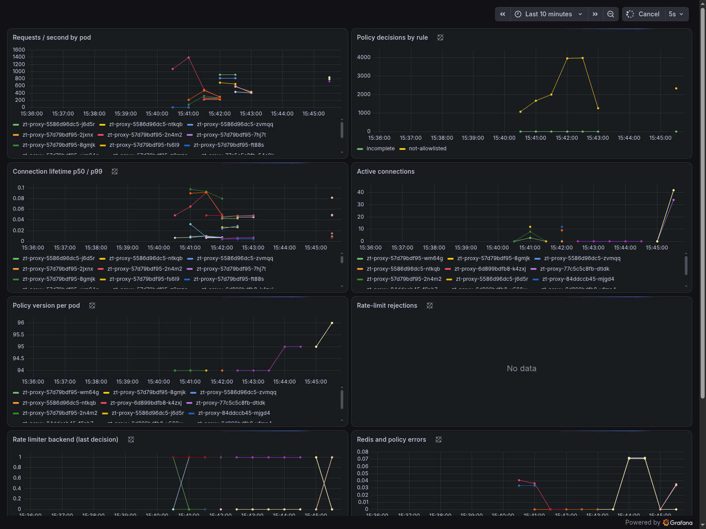
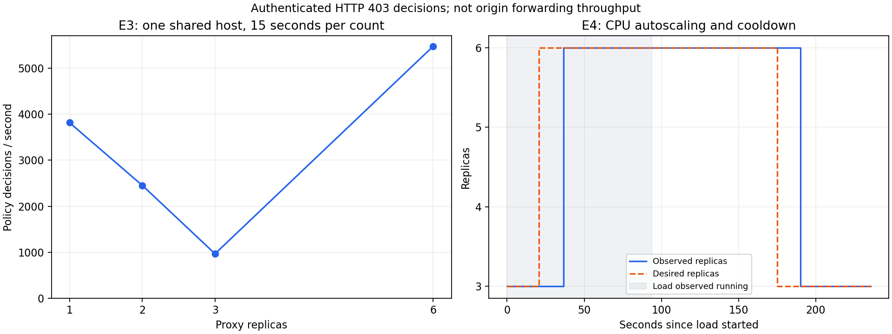
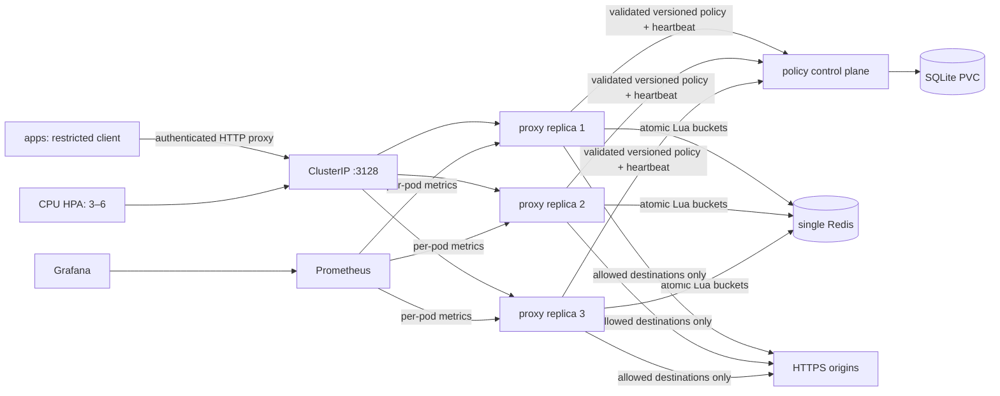

# Local Kubernetes deployment

This branch extends the C++ proxy with a versioned policy control plane, shared Redis limits, readiness/draining, Helm deployment, Calico network enforcement, autoscaling and monitoring. It runs on **one physical Linux machine**, with one kind control-plane node and two worker nodes. Redis and the policy service each have one instance. This is a local distributed-systems demonstration, not a multi-region or production deployment.

## Start and operate

Work from `/home/mohit/projects/zt-proxy` on the Linux filesystem. Docker Engine is already installed. The pinned tools install under ignored `artifacts/bin`; cluster credentials and generated secrets stay under ignored `artifacts/`.

```bash
bash scripts/k8s/install-tools.sh
source scripts/k8s/env.sh
# Commands needing Docker access can be run with sudo; kubectl/Helm use this dedicated kubeconfig.
sudo -E bash scripts/k8s/create-cluster.sh
sudo -E bash scripts/k8s/build-images.sh
bash scripts/k8s/metrics-server.sh
bash scripts/k8s/deploy.sh
bash scripts/k8s/monitoring.sh
kubectl get nodes
kubectl get pods,hpa,pdb -n zt-system
```

The cluster creator expects a `zt-proxy:local` image; on a fresh machine first run `sudo docker build -f deploy/Dockerfile -t zt-proxy:local .`. Do not install Ubuntu's `docker.io` alongside the existing Docker CE packages. The authenticated socket is not made world-writable and the setup does not add users to the Docker group. If root created the dedicated kubeconfig, give only that file back to your user with `sudo chown "$USER":"$(id -gn)" artifacts/kubeconfig`; do not print its contents.

To access the proxy and dashboards from the host, use separate terminals:

```bash
source scripts/k8s/env.sh
kubectl -n zt-system port-forward service/zt-proxy 13128:3128 19100:9100
kubectl -n zt-system port-forward service/zt-policy 18080:8080
kubectl -n monitoring port-forward service/monitoring-grafana 13000:80
kubectl -n monitoring port-forward service/monitoring-kube-prometheus-prometheus 19090:9090
```

The existing standalone Docker proxy may still occupy host port 3128, so the Kubernetes forward uses **13128**. Port-forward selects a pod; it does **not** measure Service load balancing. All load experiments execute in an `apps` pod and use the real ClusterIP Service.

Grafana is at `http://127.0.0.1:13000`, username `admin`. Its generated password is in `artifacts/secrets/grafana-password` on this machine. Open **ZT Proxy — local Kubernetes**. Prometheus is at `http://127.0.0.1:19090`. Do not commit or copy secrets into README examples. For authenticated client calls, supply the value from `artifacts/secrets/proxy-token` as the `Proxy-Authorization: Bearer ...` proxy header.

`deploy/k8s/plain.yaml` is a rendered three-replica baseline without NetworkPolicies/HPA; generated secrets must already exist. It is an instructional K2 artifact. The tested complete installation uses Helm. Do not apply the plain baseline on top of the Helm release.

## Policy operations

The service distinguishes a read/heartbeat token from an admin token. Both are mounted from Secrets; proxy pods receive only the read token, their proxy token and Redis password. The admin test pod has the admin token. The policy service validates every replacement by invoking the **same C++ `--validate-policy` implementation** used by the data plane. JSON duplicate keys and unknown fields are rejected.

With the policy port-forward running, this Python example changes the policy without putting a token in shell history:

```python
import json, pathlib, urllib.request
root = pathlib.Path('/home/mohit/projects/zt-proxy/artifacts/secrets')
request = urllib.request.Request(
    'http://127.0.0.1:18080/v1/policy', method='PUT',
    data=json.dumps({'allowlist': ['example.com'], 'denylist': [],
                     'http_allowlist': [], 'allowed_ports': [80, 443],
                     'rate': 100, 'burst': 200}).encode(),
    headers={'Content-Type': 'application/json',
             'Authorization': 'Bearer ' + (root/'policy-admin-token').read_text().strip()})
with urllib.request.urlopen(request) as response:
    print(response.read().decode())
```

`GET /v1/policy` returns `{policy, version, sha256}` with an ETag. `If-None-Match` yields 304; `?wait=30` waits for a change. `GET /v1/rollout` reports each pod's version, readiness, heartbeat time and convergence time. Heartbeats older than 45 seconds are marked stale; a deleted pod can remain visible until its lease expires. `POST /v1/policy/rollback?to=N` restores historical contents **as a new version**, so monotonic clients accept it. `GET /v1/audit` returns actor, time, old/new version and changed field names. Policy changes and audit reads require the admin token; heartbeats use the read token. SQLite history/audit transactions persist in a 256 MiB PVC; replacing the bootstrap ConfigMap does not overwrite that history.

Remote updates can change only `allowlist`, `denylist`, `http_allowlist`, `allowed_ports`, `rate`, `burst`, and the server-assigned version. They cannot change listener addresses, worker counts, credentials, test hooks or backend addresses. Policy hashes cover canonical normalized policy JSON, including its version. Same-version conflicting data and older versions are rejected. Existing connections retain their immutable policy snapshot; new connections see the accepted policy. Bootstrap policy is valid but denies every destination until the first central policy arrives.

Policy pulls and heartbeats run in a separate thread with ETag validation, jitter, size bounds and socket deadlines. If the control plane is down, the last good policy remains active; liveness and readiness do not deliberately fail merely because the policy service is unreachable. HTTP and Redis are plaintext **inside the restricted cluster**. Production would require mutual TLS and stronger per-pod identities. The read token is shared among replicas; a compromised enforcement pod could forge heartbeats for another pod. `getaddrinfo` is still a blocking libc resolver in helper threads; socket deadlines do not bound libc DNS resolution or its shutdown join.

## Limits, probes and security

Redis uses a hand-written RESP client, one persistent connection per helper thread, bounded queues, socket deadlines, reconnect backoff and `SCRIPT LOAD`/`EVALSHA` recovery. Its Lua transaction uses Redis's clock, refills a bucket and spends one token atomically. Key identity is SHA-256 of the authenticated bearer identity; it is shared across replicas. Raw tokens are not logged or used as Redis keys. The optional unauthenticated loopback mode keys by client IP.

Default Redis failure behavior falls back to the existing **per-source-IP, per-worker** limiter. This preserves availability but can allow the limit multiplied across workers and replicas; it also changes identity granularity. `redis_fail_closed: true` returns 503 instead. Redis has no persistence in this demo: a restart clears buckets and can grant a fresh burst. It uses `noeviction`; memory/backend errors trigger the configured fallback, not silent key eviction. Extremely slow refill intervals that cannot fit a safe Redis expiry remain persistent until Redis restarts. `zt_ratelimit_backend` reports the last completed backend decision, not proactive reachability; concurrent helper failures/recoveries can make it change quickly.

`/healthz` answers whether the process responds. `/readyz` becomes 200 only after listeners/workers start with a valid config. SIGTERM first makes readiness 503, then waits the configured propagation delay (3 seconds in the chart), closes listeners and drains up to 10 seconds. Kubernetes allows 45 seconds total. Existing long tunnels exceeding the drain window will still be cut off; the measured rolling-update result is specific to the documented workload, not an unlimited zero-loss guarantee.

The pod runs as UID/GID 10001, with a read-only root filesystem, all capabilities dropped, no privilege escalation, the default seccomp profile and no mounted service-account token. Secrets are separate from ConfigMaps and generated files use mode 0600 locally. `admin_allow_remote` is an explicit opt-in requiring proxy authentication; it is needed for kubelet probes and Prometheus. Admin endpoints do not themselves authenticate and therefore stay behind NetworkPolicy and local port-forwards.

Calico enforces default-deny policies in `apps`, `zt-system` and `monitoring`. App pods may reach cluster DNS and the proxy on 3128 only. Proxy pods may reach DNS, the control plane, Redis and public IPv4 80/443; the C++ all-answer IP checks additionally reject special-use destinations. Redis accepts only proxy pods. Monitoring and an explicit admin pod may read proxy admin endpoints. The local admin pod exists for experiments, not as an unrestricted application workload. Kube-system/Calico/system namespaces keep their platform networking. DNS access is necessary here and is not a general DNS-exfiltration defense.

HPA uses CPU requests of 100m per replica, a 60% target, minimum 3 and maximum 6, with a 60-second scale-down stabilization window. PDB requires two available replicas and topology spread prefers different worker nodes. PDB applies to voluntary evictions, not arbitrary crashes or direct replica-count changes. Metrics-server uses `--kubelet-insecure-tls` only for kind's local kubelet certificates. Monitoring retains one hour / 256 MB of samples, uses bounded resources and keeps dashboards in Git; the local Prometheus operator admission webhook/TLS listener is disabled together.

## Verification and experiments

```bash
source scripts/k8s/env.sh
python3 bench/k8s/run.py E1 E2 E5 E6 E7 E8 E9 E10 --repeats 20
python3 bench/k8s/scaling.py E3
python3 bench/k8s/scaling.py E4
# Separate destructive CI harness: refuses to touch an existing named cluster.
sudo -E bash scripts/k8s/check-cluster.sh
```

Experiments modify only this dedicated cluster and restore stopped services and working runtime settings in their cleanup paths; their benchmark policy and HPA state remain visible. Reapply your desired policy after running experiments. Helm 4 reconciliation uses `--force-conflicts` for this release because experiments intentionally patch fields temporarily owned by kubectl; it does not delete or replace the PVC. They should run sequentially because they change shared policy, replica counts and deployments. The CI harness creates the dedicated cluster, runs E1/E2/E5/E8/E9/E10 as pass/fail checks and tears it down. Hosted GitHub Actions remains unexecuted: this repository has not been pushed. Local CI-equivalent checks and their raw results are recorded separately.



All high-rate traffic is an authenticated request to `blocked.invalid`; the expected successful **policy decision** is HTTP 403. This measures request handling, Redis coordination and lifecycle behavior without load-testing an unrelated public website. It is **not upstream forwarding throughput**. E5 deliberately pauses 200 ms between the request line and the rest of the headers to expose interrupted in-flight work. E8 separately verifies a real TLS-verified HTTPS download from example.com. E2 checks each pod's version, SHA and denial behavior, with 20 timed block rollouts per mode; its timing includes API/kubectl/probe observation overhead. E10 explicitly injects a schema-valid conflicting-version database response to test data-plane rejection; that path is a fault injection, not a normal policy API operation.

The original HTTP/TLS benchmarks remain historical single-process measurements. Kubernetes measurements are in `bench/results/k8s/`; they were collected on one shared host with monitoring and a client limited to two cores. Scaling may flatten or regress because proxy replicas share CPU, Redis, network and load-generator capacity.

### Recorded results (9 October 2026)

| Experiment | Observed result | Raw evidence |
|---|---|---|
| E1 replacement | 2.255 s until replacement ready; 0 / 14,326 failed decisions during graceful pod deletion | [E1](../bench/results/k8s/E1.json) |
| E2 policy rollout | 20 samples each: polling p50 632.50 ms / max 715.04 ms; long-poll p50 624.12 ms / max 972.43 ms, three replicas | [E2](../bench/results/k8s/E2.json) |
| E3 replicas | See table below; results are noisy and non-monotonic | [E3](../bench/results/k8s/E3.json) |
| E4 autoscaling | 3 → 6 → 3; first observed increase at 36.62 s, back to three at 190.13 s; load lasted 90 s | [E4 timeline](../bench/results/k8s/E4.json) |
| E5 rolling update | Baseline 41 / 3,795 failures; readiness/drain 0 / 3,792 | [E5](../bench/results/k8s/E5.json) |
| E6 shared limit | At 2 tokens/s, burst 5: Redis admitted 9 / 90 versus local 53 / 90 over approximately 2.3 s | [E6](../bench/results/k8s/E6.json) |
| E7 Redis outage | Local fallback: 0 / 2,866 failed decisions; Redis recovery 14.22 s | [E7](../bench/results/k8s/E7.json) |
| E8 bypass | Direct HTTPS timed out; authenticated proxy HTTPS succeeded with certificate verification | [E8](../bench/results/k8s/E8.json) |
| E9 policy outage | Retained version and SHA; 0 / 4,326 failed decisions while service unavailable | [E9](../bench/results/k8s/E9.json) |
| E10 rejection | Invalid API policy rejected; conflicting same-version response rejected by every proxy | [E10](../bench/results/k8s/E10.json) |

E3 used `wrk -t2 -c64` for 15 seconds per count, with Redis enabled:

| Replicas | Policy decisions/s | p50 | p99 |
|---:|---:|---:|---:|
| 1 | 3,815.00 | 6.66 ms | 45.87 ms |
| 2 | 2,452.25 | 7.32 ms | 54.23 ms |
| 3 | 966.07 | 30.52 ms | 76.45 ms |
| 6 | 5,476.23 | 4.14 ms | 41.88 ms |



Recreate these plots with `python3 bench/k8s/plot.py` (matplotlib required). [Validation metadata](../bench/results/k8s/validation.json) records test counts, source/binary identity and verification limits. The final config-parser initialization cleanup was made after the cluster experiments and rechecked by the full release and sanitizer suites.

The separate three-replica [Redis comparison](../bench/results/k8s/redis-latency.json) measured local p50/p99 1.40/23.50 ms versus Redis 3.56/31.66 ms: an observed difference of 2.16/8.16 ms. These are complete request latencies under load, not isolated Redis wire times. Neither this comparison nor E3 is a statistically controlled capacity study.

The first E9 attempt tested too early: a terminating Python PID 1 still served requests during its grace period. Its [failed result](../bench/results/k8s/E9-before-outage-wait.json) is retained. The harness now waits for actual pod deletion and the service handles SIGTERM explicitly. The corrected outage test passed. Initial deployment issues also exposed Kubernetes service-link environment variables colliding with the control-plane port setting, missing Calico operator CRDs, and a disabled admission webhook paired with an enabled TLS listener; the installation scripts include those fixes.

Pinned tools: kind 0.33.0, Kubernetes/kubectl 1.36.4, Helm 4.3.0, Calico 3.33.0, metrics-server 0.9.0 and kube-prometheus-stack 92.2.0. Tool versions and the node image digest are pinned in the scripts; the installer verifies downloaded tools against their release checksum files. Docker Engine is 29.8.2. See [environment](../bench/results/k8s/environment.txt) and [live pod security settings](../bench/results/k8s/proxy-pods.yaml).

This cluster is considerably larger than the standalone Docker image: the recorded host-wide Docker and containerd directories occupied about **15.65 GB combined**, including the existing standalone service, images and caches. These directory totals are distinct from Docker's logical/shared layer sizes and do not attribute every byte solely to this project. At measurement time the Linux root filesystem had **2.36 GB available (98% used)**. See [storage measurements](../bench/results/k8s/storage-final.txt); deleting the dedicated kind cluster releases its nodes/volumes when you no longer need it.

## Architecture



## Shutdown and cleanup

Closing the terminal does not stop kind containers. Port-forward processes need their own terminal/session. To stop this Kubernetes demo and release its node/volume space:

```bash
source scripts/k8s/env.sh
sudo -E artifacts/bin/kind delete cluster --name zt-proxy
```

This deletes the cluster's SQLite history, monitoring samples and generated Kubernetes Secrets. Local ignored secret files remain for reinstall; Git/source files and the standalone Docker Compose proxy remain. Export any policy history you need before deleting the cluster. Do not run global Docker prune commands against unrelated workloads.
